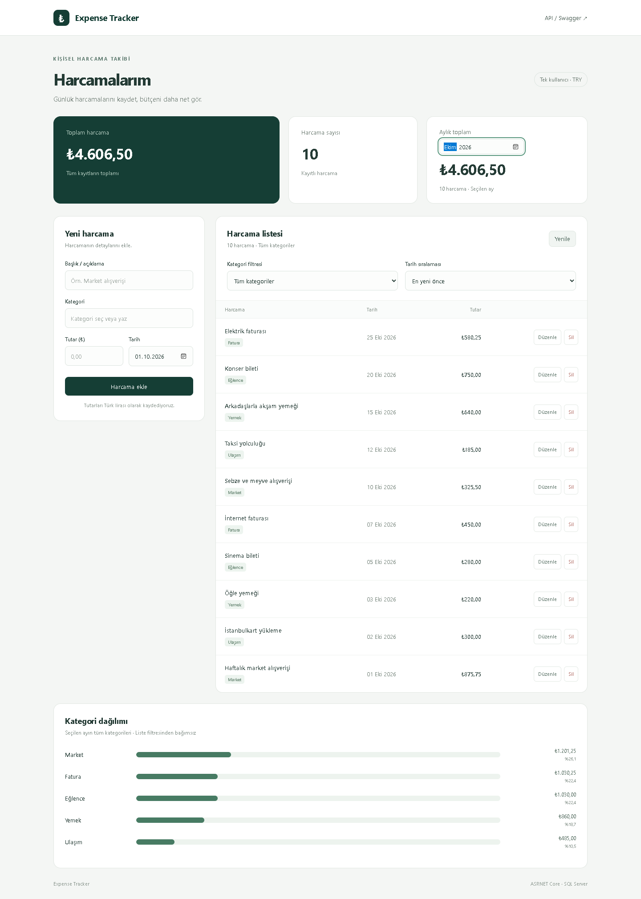
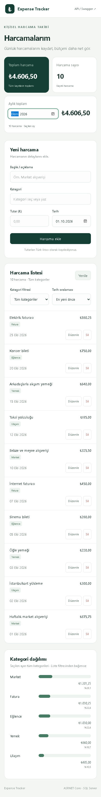

# Expense Tracker

Tarayıcıdan harcama kayıtlarını oluşturmak, listelemek, güncellemek ve silmek için geliştirilmiş bir uygulama. HTML, CSS ve vanilla JavaScript arayüzü, ASP.NET Core REST API üzerinden SQL Server ile çalışır. Proje; ASP.NET Core controller'ları, Entity Framework Core ile veritabanı işlemlerini ve DTO doğrulamasını uygulayan bir junior developer portföy çalışmasıdır.

## Ekran görüntüleri

Aşağıdaki görseller kurgusal örnek harcamalarla hazırlanmıştır.

### Masaüstü



### Mobil

<details>
<summary>Mobil görünümü aç</summary>



</details>

## Teknolojiler

| Teknoloji | Sürüm / kullanım |
| --- | --- |
| Frontend | HTML, CSS ve vanilla JavaScript; framework yok |
| .NET / ASP.NET Core | .NET 8 Web API |
| Entity Framework Core | 8.0.12; SQL Server ve migration |
| SQL Server | Windows üzerinde LocalDB ile geliştirme |
| Swashbuckle.AspNetCore | 6.6.2; Swagger UI ve OpenAPI |
| PowerShell | 7; HTTP ve veritabanı test betikleri |

## Özellikler

- Mobil uyumlu arayüz, toplam harcama tutarı ve kayıt sayısı.
- Kategoriye göre filtreleme ve tarihe göre artan/azalan sıralama.
- Ay seçimiyle aylık harcama özeti ve kategori bazlı tutar/yüzde grafiği.
- Düzenleme modalı, silme onayı ve Türkçe alan bazında validation mesajları.
- Boş liste, boş filtre sonucu ve boş aylık özet görünümleri.
- Arayüzden harcama oluşturma, listeleme, güncelleme ve silme onayı.
- API üzerinden harcama detayını görüntüleme.
- Veritabanı modelinden ayrı request ve response DTO'ları.
- Zorunlu başlık, kategori ve tarih; alan uzunluğu ve pozitif tutar kontrolü.
- İki ondalık basamaklı tutarlar için `decimal(18,2)` sütunu.
- Hatalar için ProblemDetails, doğrulama hatalarında alan bazında açıklamalar.
- EF Core migration ile veritabanı kurulumu.
- Swagger üzerinden endpointleri deneme ve otomatik HTTP testleri.

Proje tek kullanıcılı bir demodur. Kimlik doğrulama, kullanıcı bazında veri ayrımı ve sayfalama içermez. Tutarların aynı para biriminde olduğu kabul edilir. API listesi, harcama tarihi ve ardından ID'ye göre azalan sırada döner; arayüzde tarih sıralaması değiştirilebilir.

## Gereksinimler

- [.NET SDK](https://dotnet.microsoft.com/download/dotnet/8.0): .NET 8 hedefini build edebilen SDK ve .NET 8 runtime. Proje SDK 9.0.200 ile doğrulandı.
- SQL Server Express LocalDB (Windows) veya erişilebilir bir SQL Server instance'ı.
- Test betikleri için PowerShell 7. Doğrudan SQL kontrolü için ayrıca `sqlcmd`.

Visual Studio ve SQL Server Management Studio zorunlu değildir.

## SQL Server / LocalDB kurulumu

Windows'ta LocalDB'yi Visual Studio Installer üzerinden **SQL Server Express LocalDB** bileşenini seçerek veya SQL Server kurulum medyasındaki `SqlLocalDB.msi` ile kurabilirsiniz. Ayrıntılar: [Microsoft LocalDB kurulum belgesi](https://learn.microsoft.com/en-us/sql/database-engine/configure-windows/sql-server-express-localdb).

Kurulumu kontrol edin:

```powershell
sqllocaldb info
sqllocaldb info MSSQLLocalDB
```

`MSSQLLocalDB` instance'ı yoksa oluşturup başlatın:

```powershell
sqllocaldb create MSSQLLocalDB
sqllocaldb start MSSQLLocalDB
```

Instance zaten varsa yalnızca `sqllocaldb start MSSQLLocalDB` yeterlidir.

Tam SQL Server veya SQL Express kullanmak için SQL Server'ı kurun, instance adını belirleyin ve ilgili Database Engine servisinin çalıştığından emin olun. Bağlantı hesabının migration için veritabanı oluşturma veya şema değiştirme yetkisi olmalıdır. LocalDB yalnızca Windows'ta kullanılabilir.

## Kurulum ve çalıştırma

Terminali `ExpenseTrackerApi.csproj` dosyasının bulunduğu klasörde açın.

**1. Yerel ayar dosyasını hazırlayın.** Yeni bir kopyada:

```powershell
Copy-Item appsettings.Development.example.json appsettings.Development.json
```

Mevcut `appsettings.Development.json` dosyanız varsa bu adımı atlayın; özel ayarlarınızı koruyun. Örnek dosya yalnızca parolasız yerel LocalDB bağlantısı içerir. Asıl geliştirme ayar dosyası Git dışında tutulur.

**2. Paketleri ve projeye özel EF aracını yükleyin.**

```powershell
dotnet restore
dotnet tool restore
```

**3. Veritabanını oluşturun ve migration uygulayın.**

```powershell
$env:ASPNETCORE_ENVIRONMENT = 'Development'
dotnet ef database update
```

Bu komut `ExpenseTrackerPortfolio` veritabanını, `Expenses` tablosunu ve migration geçmişini oluşturur. Tekrar çalıştırıldığında yalnızca bekleyen migration'ları uygular. API açılırken migration otomatik çalışmaz.

**4. API'yi başlatın.**

```powershell
dotnet run --launch-profile http
```

Ana uygulama: [http://localhost:5011](http://localhost:5011)

Swagger: [http://localhost:5011/swagger](http://localhost:5011/swagger)

Terminalde `Ctrl+C` ile durdurabilirsiniz. HTTPS profili için yerel geliştirme sertifikası gerekir; yukarıdaki HTTP profili yerel test için yeterlidir.

### Başka bir SQL Server bağlantısı kullanma

Bağlantıyı kendi Git dışında tutulan `appsettings.Development.json` dosyanızda değiştirebilir veya aynı terminal oturumunda ortam değişkeniyle sağlayabilirsiniz. Windows kimlik doğrulaması kullanan yerel SQL Express örneği:

```powershell
$env:ConnectionStrings__DefaultConnection = 'Server=.\SQLEXPRESS;Database=ExpenseTrackerPortfolio;Trusted_Connection=True;TrustServerCertificate=True'
$env:ASPNETCORE_ENVIRONMENT = 'Development'
dotnet ef database update
dotnet run --launch-profile http
```

Gerçek sunucu adreslerini, kullanıcı adlarını ve parolaları örnek dosyaya yazmayın. Ortam değişkeni JSON ayarını geçersiz kılar. `TrustServerCertificate=True` yerel geliştirme örneğidir; barındırılan ortamda geçerli TLS sertifikası kullanın. Development dışında bağlantı ayrıca sağlanmalıdır; Swagger yalnızca Development ortamında açıktır.

## API endpointleri

| Metot | Endpoint | Başarılı yanıt | Diğer yanıtlar |
| --- | --- | --- | --- |
| GET | `/api/expenses` | 200; liste, kayıt yoksa `[]` | — |
| GET | `/api/expenses/{id}` | 200; tek kayıt | 404 |
| POST | `/api/expenses` | 201; kayıt ve `Location` başlığı | 400 |
| PUT | `/api/expenses/{id}` | 204; boş gövde | 400, 404 |
| DELETE | `/api/expenses/{id}` | 204; boş gövde | 404 |

POST ve PUT için örnek gövde:

```json
{
  "title": "Market alışverişi",
  "amount": 250.50,
  "category": "Gıda",
  "date": "2026-10-01"
}
```

Başlık en fazla 100, kategori en fazla 50 karakterdir; boş bırakılamazlar. Tutar `0.01`–`9999999999999999.99` aralığında ve en fazla iki ondalık basamaklı olmalıdır. Tarih zorunludur ve `YYYY-MM-DD` biçiminde gönderilir. ID sunucuda üretilir.

POST yanıtı aynı alanlara ek olarak `id` içerir:

```json
{
  "id": 1,
  "title": "Market alışverişi",
  "amount": 250.50,
  "category": "Gıda",
  "date": "2026-10-01"
}
```

## Swagger ile test

1. `POST /api/expenses` bölümünde **Try it out** seçin, örnek gövdeyi girip **Execute** ile gönderin. 201 yanıtındaki ID'yi alın.
2. `GET /api/expenses` ile kaydın listede olduğunu kontrol edin.
3. `GET /api/expenses/{id}` ile oluşturulan kaydı görüntüleyin.
4. `PUT /api/expenses/{id}` ile tutarı değiştirin; 204 yanıtından sonra GET ile yeni değeri kontrol edin.
5. Boş başlık veya negatif tutar içeren POST gönderin; 400 yanıtındaki `errors` alanını inceleyin.
6. `DELETE /api/expenses/{id}` ile kaydı silin; aynı ID için GET artık 404 döndürmelidir.

`ExpenseTrackerApi.http` dosyası da örnek istekler içerir.

## Build ve otomatik testler

```powershell
dotnet build
```

API çalışırken ikinci bir PowerShell 7 terminalinde:

```powershell
.\scripts\smoke-test.ps1
```

Bu betik Swagger, CRUD, validation ve 404 yanıtlarını kontrol eder.

Windows LocalDB ve `sqlcmd` kuruluysa doğrudan SQL doğrulaması da içeren test:

```powershell
.\scripts\e2e-test.ps1
```

E2E betiği `ExpenseTrackerPortfolio` LocalDB veritabanına göre hazırlanmıştır; farklı SQL Server bağlantıları için SQL kontrol kısmını uyarlayın. Betikler kendi deneme kayıtlarını oluşturur ve başarılı test sonunda siler. Yarıda kalan bir testin kaydı veritabanında kalabilir. Ayrı bir unit test projesi yoktur.

## Proje yapısı

```text
wwwroot/          HTML, CSS ve JavaScript arayüzü
Controllers/      HTTP endpointleri ve CRUD işlemleri
Dtos/             İstek doğrulaması ve yanıt yapıları
Models/           Expense veritabanı modeli
Data/             DbContext ve sütun yapılandırması
Migrations/       EF Core şema geçmişi
Properties/       Yerel çalıştırma profilleri
.config/          Projeye özel dotnet-ef aracı
scripts/          HTTP, SQL ve tarayıcı entegrasyon kontrolleri
screenshots/      Kurgusal örnek verilerle arayüz görüntüleri
```

## Yerel dosyalar

`.gitignore`; `bin/`, `obj/`, IDE kullanıcı ayarları, gerçek geliştirme/üretim ayarları, `.env` dosyaları, sertifika özel anahtarları ve veritabanı dosyalarını dışarıda tutar. `appsettings.Development.example.json` paylaşılabilir kurulum örneğidir. Gerçek bağlantı bilgileri ve kişisel ayarlar yerel dosyalarda veya ortam değişkenlerinde saklanmalıdır.

## Arayüzü kullanma

Ana sayfadaki formdan başlık, kategori, tutar ve tarih girerek harcama ekleyin. Harcama listesi ve toplamlar kayıttan sonra otomatik yenilenir. Bir kaydın Düzenle düğmesi bilgileri modal pencerede açar; değişiklikleri kaydetmek PUT isteği gönderir. İptal veya Escape, değişiklikleri kaydetmeden pencereyi kapatır. Sil düğmesi bir onay penceresi açar. Veriler tarayıcı belleğinde değil, SQL Server'da saklanır.

`wwwroot/index.html` sayfa yapısını, `styles.css` mobil uyumlu görünümü, `app.js` ise mevcut GET/POST/PUT/DELETE endpointleriyle iletişimi yönetir. Arayüz ve API aynı sunucuda çalışır; ayrı frontend sunucusu gerekmez. Tutarlar TRY olarak gösterilir. Arayüzde güvenilir JavaScript tutar hesapları için tek kayıt tutarı en fazla 999999999999.99 olarak sınırlandırılmıştır.

### Gerçek tarayıcı testi

`scripts/frontend-test.cjs`, izole bir Edge oturumunda formu kullanarak ekleme, listeleme, sayfa yenileme sonrası kalıcılık, düzenleme ve silme işlemlerini test eder. SQL sorgularıyla kayıt değişikliklerini, toplamları, 390 piksel mobil görünümü ve Swagger erişimini doğrular.

Bu ek geliştirme testi için Node.js, Playwright paketi, Microsoft Edge ve sqlcmd gerekir; uygulamayı normal çalıştırmak için Node.js veya Playwright gerekmez. Playwright kurulu bir Node ortamında, uygulama çalışırken:

```powershell
node scripts/frontend-test.cjs
```

Ekran görüntüleri Git dışında tutulan `TestResults/` klasörüne yazılır. Test kendi oluşturduğu kaydı sonunda temizler.

## Filtreler ve harcama özeti

Kategori filtresi yalnızca harcama listesini daraltır. Tarih sıralaması en yeni veya en eski kayıtları önce gösterebilir. Üstteki toplam tutar ve kayıt sayısı tüm harcamaları kapsar.

Aylık toplam kartındaki ay seçimi hem aylık toplamı hem de kategori dağılımı grafiğini günceller. Çubuk grafik, seçilen ayın tüm kategorilerini tutar ve yüzde payıyla gösterir; liste filtresinden bağımsızdır. Seçilen ayda kayıt yoksa boş özet gösterilir. Formdaki hatalar Türkçe ve ilgili alanın altında açıklanır.

Ek özellikleri gerçek tarayıcıyla kontrol etmek için, uygulama çalışırken Playwright kurulu Node ortamında:

```powershell
node scripts/frontend-features-test.cjs
```

Bu test kategori filtresi, tarih sıralaması, aylık toplamlar, grafik yüzdeleri, modal iptali, validation ve mobil/boş görünümleri kontrol eder; oluşturduğu test kayıtlarını temizler.

## Veritabanı ve örnek kayıtlar

Geliştirme veritabanındaki kayıtlar Git repository'sinin parçası değildir. Migration dosyaları yalnızca şemayı oluşturur; örnek kayıt ekleyen seed işlemi yoktur. Yeni kurulumda veritabanı boş başlar. Ekran görüntülerinde görünen 10 harcama test amacıyla üretilmiştir ve yerel LocalDB'de tutulur; repository'de bir veritabanı yedeği veya veri dışa aktarımı bulunmaz.

Yerel `appsettings.Development.json` Git dışında tutulur. Paylaşılan örnek ayar ve README bağlantıları yalnızca parolasız localhost/LocalDB örnekleridir. Uygulamaya gerçek bağlantı bilgisi eklerken Git dışında tutulan yerel dosyayı veya ortam değişkenini kullanın.
